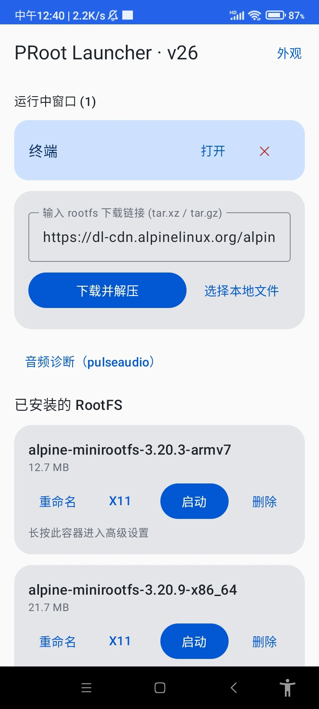
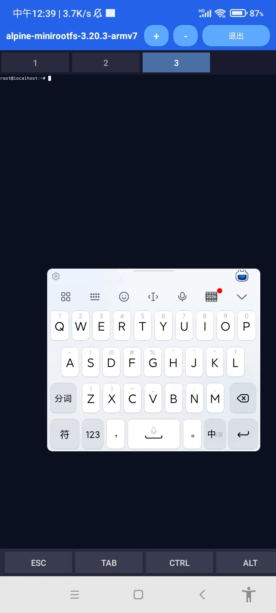
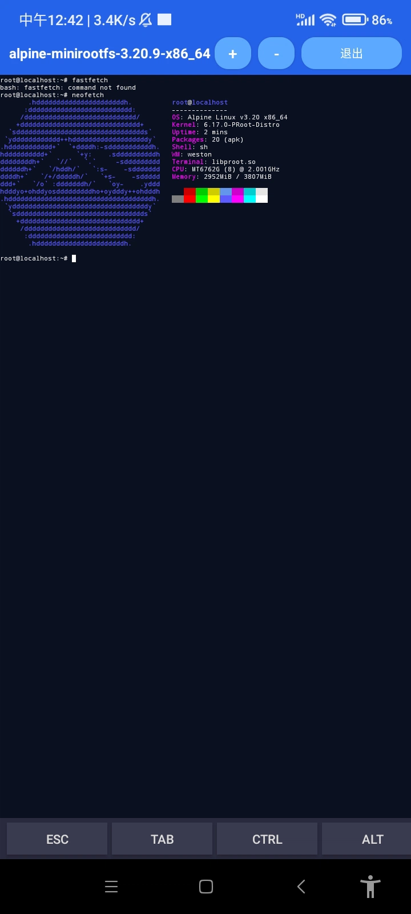
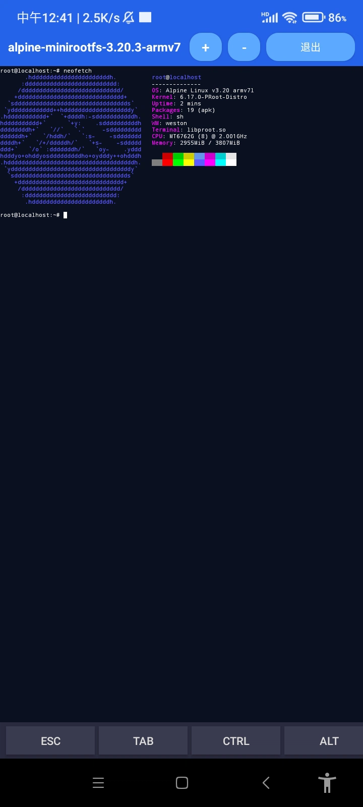

# PRoot Launcher

[](LICENSE)
[](https://github.com/1103425772/PRootLauncher/releases)

**在 Android 上跑完整 Linux，不用 root。**

<p>




</p>

当前版本 **v37.2 / 1.17.2**（versionCode 56）。下载见 [Releases](https://github.com/1103425772/PRootLauncher/releases)。

---

## 它能做什么

| 能力 | 说明 |
|---|---|
| **下载即跑** | 主界面填 rootfs 下载链接（`.tar.gz` / `.tar.xz`）或选本地文件，自动解压、修权限、识别发行版 |
| **真终端，不是玩具** | 接入 Termux `terminal-emulator` / `terminal-view` 源码 + `libtermux.so`，完整 pty、ANSI 彩色、光标、退格、Ctrl 组合键都正常 |
| **多标签** | 单个窗口最多 5 个终端会话，标签栏点击切换，长按关闭 |
| **快捷键栏** | `ESC` `TAB` `CTRL` `ALT` `HOME` `↑` `END` `PGUP` `←` `↓` `→` `PGDN`；`CTRL`/`ALT` 是 toggle，点亮后下一次按键自动带修饰 |
| **最小化回主界面** | 点 `-` 或系统返回键直接回主界面，proot 进程留在后台继续跑，不 `finish`、不 `shutdown` |
| **运行中窗口列表** | 主界面顶部列出所有活着的终端窗口，点「打开」切回去，点「✕」直接关掉 |
| **跨架构** | 内置 QEMU（arm64 + arm 32 位两套），自动探测 rootfs 架构，天玑 7300 上跑 `ubuntu-amd64` 的 `apt update` 实测正常 |
| **三种启动方式** | 长按容器项：Web 终端（自动装 ttyd）/ 进入 RootFS（Shell）/ 运行 X11 程序 |
| **X11** | 用 `app_process` 拉起 Termux:X11 server，旧版 loader 自动回退（修 Android 12+ 的 exit 134） |
| **声音** | 内置 pulseaudio 17.0 + AudioTrack 桥接，走 AAudio 降级链，Android 16 正常出声 |
| **本地 API** | 一套 REST + WebSocket + 裸 TCP 三种接入，所有功能都能远程调用：列 rootfs、下载/删除/重命名、起会话、转发终端、端口转发 |
| **自定义 DISPLAY** | 主界面可填任意 `DISPLAY`（`:0` / `:1` / `127.0.0.1:10.0`），也可按单次会话覆盖 |
| **主题** | Material 3，12 种预设色 + 任意 HEX，浅色/深色/跟随系统 |

---

## 快速开始

1. 从 [Releases](https://github.com/1103425772/PRootLauncher/releases) 下载 `PRootLauncher-v37.2-hi.apk`（Android 12+）。
2. 安装后打开，主界面已预填 Alpine 官方源地址，直接点「下载并解压」。
3. 列表里出现的发行版点「启动」进终端，输 `neofetch` 试试。
4. 想跑桌面就装 [Termux:X11](https://github.com/termux/termux-x11)，长按容器项选「运行 X11 程序」。

装应用需要给「所有文件访问权限」，否则解压 rootfs 会失败。

---

## 终端操作

**标签**
右上角 `+` 新建（上限 5 个），标签栏点数字切换，长按标签关闭。

**快捷键栏**
底部一排 `ESC TAB CTRL ALT HOME ↑ END PGUP ← ↓ → PGDN`。
`CTRL` / `ALT` 点一下高亮，下一次按键自动加修饰，按完其他键自动取消。
`vim`、`less`、`top`、`htop` 都能正常用。

**最小化 vs 退出**
- `-` 按钮 / 返回键 → 回主界面，容器继续在后台跑
- `退出` 按钮 → 结束会话，收回资源

**主界面「运行中窗口」**
每张卡片显示 rootfs 名称，`打开` 切回终端，`✕` 关闭。主界面本身也算一个窗口，回到这里就能再选别的发行版另开一个，互不干扰。

---

## 本地 API

主界面「本地 API」开关打开后，App 会在本机起两个端口，一套逻辑三种接入：

| 通道 | 地址 | 说明 |
|---|---|---|
| HTTP REST | `http://127.0.0.1:8765/api/v1/...` | 查询、管理 |
| WebSocket | `ws://127.0.0.1:8765/api/v1/ws` | 通用控制，一行一个 JSON 请求 |
| WebSocket（终端） | `ws://127.0.0.1:8765/api/v1/sessions/{id}/ws` | 终端双向流，含回滚快照 |
| 裸 TCP | `tcp://127.0.0.1:8766` | 一行一个 JSON，`nc` 可直接用 |

**默认不需要 token**：服务只监听 `127.0.0.1`，本机任何程序直接访问即可。只有打开「允许局域网访问」（绑定 `0.0.0.0`）时才要求 token，此时用 `X-Api-Token` 请求头或 `?token=` 传入。

> v37.2 起握手阶段不再做 WS 鉴权，`ws://127.0.0.1:8765/api/v1/ws` 直接可连，不会再有 401。

### 端点

| 方法 | 路径 | 作用 |
|---|---|---|
| GET | `/api/v1/status` | 版本、端口、会话数、当前 DISPLAY |
| GET | `/api/v1/settings` | 读 DISPLAY / X11 开关 |
| POST | `/api/v1/settings/display` | 写自定义 DISPLAY，`{"display":":1"}` |
| POST | `/api/v1/settings/x11` | 开关 X11 注入，`{"enabled":true}` |
| GET | `/api/v1/rootfs` | 列出已安装 rootfs |
| POST | `/api/v1/rootfs` | 异步下载并解压，`{"url":"...","name":"可选"}`，返回 task |
| DELETE | `/api/v1/rootfs/{name}` | 删除 |
| POST | `/api/v1/rootfs/{name}/rename` | 重命名，`{"to":"新名字"}` |
| GET | `/api/v1/tasks/{id}` | 下载任务进度（`percent` / `stage` / `state`） |
| GET | `/api/v1/sessions` | 列出会话 |
| POST | `/api/v1/sessions` | 起会话，`{"rootfs":"alpine-x86_64","cmd":"可选","display":":1"}` |
| GET | `/api/v1/sessions/{id}` | 会话详情 |
| DELETE | `/api/v1/sessions/{id}` | 结束会话 |
| POST | `/api/v1/sessions/{id}/input` | 写入按键，`{"data":"ls\n"}` |
| GET | `/api/v1/sessions/{id}/output?since=N&limit=200` | 增量读输出 |
| GET / POST | `/api/v1/forward` | 列 / 加端口转发，`{"listen":8080,"port":80}` |
| DELETE | `/api/v1/forward/{id}` | 删转发 |

### 用 curl 走一遍

```bash
TK=$(curl -s http://127.0.0.1:8765/api/v1/status | sed 's/.*"token":"\([^"]*\)".*/\1/')
curl -s -H "Authorization: Bearer $TK" http://127.0.0.1:8765/api/v1/rootfs

# 起一个 x86_64 会话，并指定 DISPLAY
curl -s -X POST -H "Authorization: Bearer $TK" -H 'Content-Type: application/json' \
  -d '{"rootfs":"alpine-3.20.9-x86_64","display":":1"}' \
  http://127.0.0.1:8765/api/v1/sessions

# 往里敲命令
curl -s -X POST -H "Authorization: Bearer $TK" -H 'Content-Type: application/json' \
  -d '{"data":"neofetch\n"}' http://127.0.0.1:8765/api/v1/sessions/<id>/input
```

### 用裸 TCP

```bash
nc 127.0.0.1 8766
{"method":"GET","path":"/api/v1/status","token":"<token>"}
```

### 自定义 DISPLAY

`POST /api/v1/settings/display {"display":":1"}` 或主界面输入框设置后，下次点 X11 / 起会话会：

1. 把 X server 真正启动在 `:1`（不是像以前硬编码 `:0`）；
2. 容器内注入 `DISPLAY=:1`；
3. `.X11-unix/X1` 通过 proot bind 进 rootfs 的 `/tmp/.X11-unix`。

> 只支持本地编号写法（`:0` / `:1` / `:2`）。`127.0.0.1:10.0` 这种会归一化成 `:10`，因为 X server 只监听 unix socket，不监听 TCP。

### 端口转发

`POST /api/v1/forward {"listen":8080,"port":80}` 之后，本机 `:8080` 会转发到容器里的 `:80`，本质是 `127.0.0.1` 上的端口映射，用来把容器内的服务（比如 ttyd、HTTP 应用）暴露出来。

## 跨架构模拟

不用手动配 qemu。启动时自动 `detectRootfsArch` 探测 rootfs 真实架构，和你选的目标架构不一致就自动纠正，然后引导对应 `qemu-user`。

支持 `x86_64` / `i386` / `arm` / `aarch64` / `m68k` / `ppc` / `ppc64` / `riscv64` / `riscv32`，已自动隐藏与本机相同的架构。

**为什么必须内置、不能放 files 目录**
Android 16 的 W^X 禁止从 app 私有 `files/` 目录 mmap 可执行 `.so`，导致
`CANNOT LINK EXECUTABLE libqemu_x86_64.so: library "libandroid-shmem.so" not found`。
所以：

- 全部 qemu 二进制和依赖库打进 `nativeLibraryDir`（`jniLibs/`）
- 13 个无版本号后缀的库直接复制进 `jniLibs/`
- 10 个带 SONAME 版本号的库（`libglib-2.0.so.0`、`libdw.so.1`、`libz.so.1` 等）AGP 会按 `lib*.so` 规则过滤掉，改用 ndk-build `PREBUILT` + `LOCAL_MODULE_FILENAME` 编译，再用 `zip -0 -r` 追加进 APK 的 `lib/<abi>/`，最后 `zipalign` + `apksigner` 重签名

`assets/qemu/arm64/lib/` 23 个库，`assets/qemu/arm/lib/` 22 个库。

---

## 构建

依赖 JDK 17、Android SDK（platform 36 / build-tools 34.0.0）、NDK 26.1。

```bash
# Android 12+ (targetSdk 34)
gradle :app:assembleHiRelease

# Android 9-11 (targetSdk 28)
gradle :app:assembleLoRelease
```

**注意**：AGP 构建完的 APK 缺 10 个带版本号后缀的 qemu 库，必须手动补齐再签名：

```bash
MB=app/build/intermediates/merged_jni_libs/hiRelease/mergeHiReleaseJniLibFolders/out
mkdir -p /tmp/qemulibs/lib/arm64-v8a /tmp/qemulibs/lib/armeabi-v7a
for f in libglib-2.0.so.0 libgmodule-2.0.so.0 libdw.so.1 libelf.so.1 libhogweed.so.6 \
         libnettle.so.8 libz.so.1 libzstd.so.1 liblzma.so.5 libbz2.so.1.0; do
  cp $MB/arm64-v8a/$f /tmp/qemulibs/lib/arm64-v8a/
  cp $MB/armeabi-v7a/$f /tmp/qemulibs/lib/armeabi-v7a/
done
cp app/build/outputs/apk/hi/release/app-hi-release.apk /tmp/app-unsigned.apk
cd /tmp/qemulibs && zip -0 -r -q /tmp/app-unsigned.apk lib/
zipalign -f 4 /tmp/app-unsigned.apk /tmp/app-aligned.apk
apksigner sign --ks keystore/debug.keystore --ks-pass pass:android \
  --key-pass pass:android --out /tmp/app-signed.apk /tmp/app-aligned.apk
```

签名固定用项目内 `keystore/debug.keystore`（`android`/`android`），保证覆盖升级不丢 rootfs。
证书 SHA-256：`84e5e6eafea116099ccfe41af44a03590fd43ee4022fcde9bb552eb8ea0cc0ce`

---

## 目录

```
app/src/
  main/kotlin/com/proot/launcher/
    MainActivity.kt        主界面（Compose Material 3）：下载 / 列表 / 运行中窗口 / 外观
    ThemeSettings.kt       主题：模式 + 种子色 → ColorScheme
  main/java/com/proot/launcher/
    TerminalActivity.java  终端窗口：多标签 / 快捷键栏 / 最小化 / 窗口注册表
    TermuxTerminal.java    Termux 终端封装：pty、修饰键、view 可见性
    WebTerminalActivity.java  ttyd web 终端
    ProotInstaller.java    proot 命令拼装 + env 注入（PULSE_SERVER / DISPLAY / QEMU）
    SimConfig.java         files/config/launch.conf（真实模拟开关 + 跨架构 + 命令模板）
    ContainerService.java  前台服务：容器会话后台保活
    X11Support.java        X11 双模式启动 + XKB + 版本检测
    AudioSupport.java      pulseaudio 启停 + TCP 4713
    AudioBridge.java       AudioTrack ↔ FIFO PCM 桥（焦点先行 + 可播性探测）
    AudioService.java      mediaPlayback 前台服务
    QemuSupport.java       qemu-user 跨架构引导
    GpuSupport.java        llvmpipe / Wayland env（无 VirGL）
    TtydService.java       ttyd web 终端服务
  main/java/com/termux/terminal/    Termux terminal-emulator 源码（18 个类）
  main/java/com/termux/view/        Termux terminal-view 源码
  main/jni/                 termux.c + Android.mk（libtermux.so + 10 个 PREBUILT 库）
  main/jniLibs/<abi>/       libproot / libproot_loader / libpulseaudio / libtermux / qemu + 依赖
  main/assets/qemu/<abi>/lib/   内置 qemu 运行时（arm64 23 个 / arm 22 个）
  main/assets/audio/<abi>/      pulseaudio 17.0 运行时（Termux deb 解包）
  main/assets/proot/            proot 静态二进制（.so 命名，装后 exec）
  main/assets/termux-exec/      termux-exec（容器内命令包装）
  main/assets/x11/loader.apk    旧版 loader stub
  hi/AndroidManifest.xml    targetSdk 34
  lo/AndroidManifest.xml    targetSdk 28
```

---

## 兼容性

| 项目 | 状态 |
|---|---|
| Android 16（天玑 7300-Ultra） | 已验证：`ubuntu-amd64` / `alpine` 跨架构正常 |
| Android 12+ | 支持（W^X 限制已通过 nativeLibraryDir 绕过） |
| Android 9-11 | `lo` 变体 |
| arm64-v8a / armeabi-v7a | 两套 qemu 都内置，离线可用 |
| VirGL / Mesa Zink 硬件加速 | 不支持，纯 llvmpipe 软渲染 |

---

## 致谢

打包/借鉴了这些开源项目：

- **[Termux](https://github.com/termux/termux-app)** — `terminal-emulator` / `terminal-view` 源码（ANSI 与 pty 基础）、`assets/audio/` 内 pulseaudio 17.0 与 libpulse（GPLv2/LGPL）
- **[proot](https://github.com/proot/proot)** — 用户空间 chroot（静态编译，GPLv2）
- **[pulseaudio](https://gitlab.freedesktop.org/pulseaudio/pulseaudio)** — 声音服务器（LGPLv2.1）
- **[Termux:X11](https://github.com/termux/termux-x11)** — X server 与 `app_process` 启动方式
- **[tur-packages](https://github.com/termux-user-repository/tur)** — qemu-user 跨架构包
- **[Tiny Container](https://github.com/Cateners/tiny_container)** — 「运行带有容器检测的二进制」启动命令参考
- **[PCL](https://github.com/Meloong-Git/PCL)** — 蓝色 UI 风格参考
- **[Compose Material 3](https://developer.android.com/jetpack/androidx/releases/compose-material3)** — UI 组件（Apache 2.0）
- **[XZ for Java](https://tukaani.org/xz/java.html)** — tar.xz 解压（公有领域）

rootfs 由用户自行下载（Alpine / Ubuntu / Debian 等），本仓库不附带 rootfs 二进制。

---

## 许可

本项目**自有代码**采用 [MIT License](LICENSE) —— 可自由使用、修改、商用、再分发，只需保留版权声明。

以下第三方组件**不受 MIT 覆盖**，分别遵循其上游许可，分发时请一并遵守：

| 路径 / 组件 | 上游许可 |
|---|---|
| `app/src/main/java/com/termux/terminal/`、`com/termux/view/` | GPLv2（Termux terminal-emulator / terminal-view） |
| `assets/proot/`、`libproot.so` | GPLv2（proot） |
| `assets/audio/`（pulseaudio 17.0）、`libpulseaudio.so` | LGPLv2.1（pulseaudio） |
| `assets/qemu/`、`libqemu_*.so` | GPLv2（QEMU） |

如果你把本项目改成闭源商业发布，需要先自行替换掉上表列出的 GPL 组件（例如改用系统自带 proot 或自行实现），否则整体分发仍需满足 GPL。
